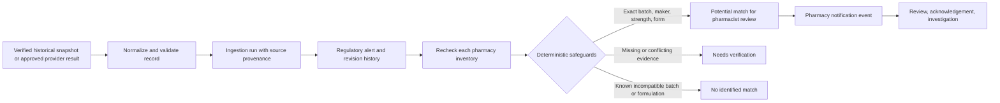

# PharmaOne monitoring design

The monitoring path turns a regulated source record into a pharmacy-specific review signal. It does not declare a recall, block dispensing, or replace pharmacist assessment.

## Delivery status

| Component | Status | Evidence or limit |
|---|---|---|
| Historical playback and provenance | TESTED | Repeated verified-snapshot playback is idempotent and runs in an in-memory database. |
| Matching and notification lifecycle | TESTED | Local database tests cover deduplication, revisions, matches, acknowledgements, and inactive prior events. |
| Bounded scheduled ingestion implementation | TESTED | Policy, local lock, request budget, retries, and disabled default have coverage. |
| Live provider monitoring | NOT IMPLEMENTED | No paid or live provider request was made. |
| Hosted observability and alert delivery | NOT IMPLEMENTED | No production monitoring service or notification channel was configured. |

## Data flow

## Source lifecycle and freshness

Each ingestion run records a source kind and sanitized retrieval metadata. The API presents these distinct states:

- A verified historical snapshot is clearly labelled as historical and does not supply a live-source timestamp.
- A successful operator check supplies the last successful source-check time and source count.
- A failed operator check retains the prior successful check time and reports source unavailability without exposing provider details.
- A never-synced deployment reports no source check.

Historical playback uses the checked-in evidence and an in-memory database. It cannot invoke the provider, change the local demo database, or be displayed as a current official source check.

## Ingestion cadence and spend guardrails

`api/app/scheduled_ingest.py` is a CLI-only, one-shot entry point. It has no public HTTP trigger and no API background loop. Its default policy is disabled and only accepts a strict boolean environment value.

When an approved operator enables it, the code allows:

- one or two provider requests per run;
- one through 25 records per run;
- a six through 168 hour interval; and
- retries only inside the configured request budget.

An overlapping local run is refused. A failed or interrupted operator run consumes the interval budget. The production deployment runbook requires an explicit provider-cost approval before an external scheduler invokes the command.

## Alert revisions and matching

Normalized alerts use a stable fingerprint and retain revisions when the material source content changes. Each source update triggers a full recheck for every pharmacy inventory item. Existing pairs are updated, stale notification events become inactive, and new material revisions receive a new notification event. Repeating an unchanged source does not create duplicate alerts, versions, or notifications.

Matching is intentionally conservative:

- exact normalized batch identity is mandatory for a potential match;
- manufacturer, strength, dosage form, and stated release must agree;
- missing or contradictory critical fields become `needs_verification`;
- a known batch, formulation, ingredient, or release conflict is not identified as a match; and
- optional MiniLM similarity only retrieves an additional review candidate and cannot override deterministic evidence.

Every potential match requires pharmacist review. An NSQ entry is a source finding, not a recall instruction.

## Pharmacy notification lifecycle

`monitoring_notifications` is pharmacy-scoped and has a unique `(pharmacy_id, event_id)` pair. A notification carries the inventory and alert references, matching status, active/read state, user-facing title/message, and creation time.

The dashboard obtains unread active notifications only for the authenticated pharmacy. A read action is idempotent. A revised alert produces a new active event and deactivates the superseded event; acknowledgement of the old event remains retained. Investigation records retain their review history across rechecks.

## Operational signals to capture after approval

The hosted service should record and alert on:

- ingestion outcome, source kind, reporting period, request count, record count, and elapsed time;
- source freshness age and the last successful source check;
- number of new, revised, active, and acknowledged notification events;
- potential-match and verification queue sizes;
- scheduler skips, lock contention, retry budget exhaustion, and sanitized provider failures;
- API 401, 403, 404, 429, and 5xx rates; and
- database connection saturation, migration outcomes, backup result, and restore-test evidence.

Do not include tokens, provider keys, raw authorization headers, uploaded evidence content, or personally identifying pharmacy data in public logs or metric labels.

## Current limitations

The rate limiter is process-local and needs a shared backing store for multi-instance enforcement. Hosted metrics, paging, provider spend alerts, and delivery-channel integration are design follow-ups. Local PostgreSQL migration execution is also pending; SQLite does not test RLS, grants, advisory locking, or the PostgreSQL catalog contract.
